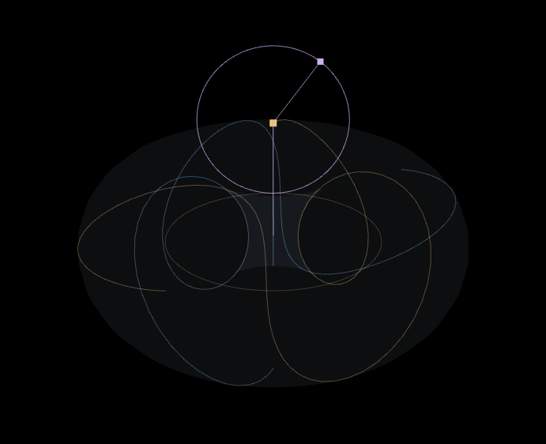

# 元のトーラスに第3の円運動を追加する

第3オン時に、元の2円の先端Pを中心にもう1つの円を追加する。Pのトーラスと、選択した陰陽の対を保ったまま、第3の円とその先端Qが内外を動く。初期表示は円と先端で、Qの履歴の軌跡は調整から明示的にオンにできる。第3オフでは従来の計算と元の幾何学digestを保持する。



- [先端が内側へ入ったstep 250](third-circle/desktop-250.png)
- [円が動く4秒MP4](third-circle/third-circle.mp4)
- [390×844の操作と表示](third-circle/mobile-170.jpg)
- [撮影条件・先端の座標・保存前後・負荷の記録](third-circle/capture.json)
- [独立した高精度計算との照合](third-circle/math-review.json)

## 3つの円の定義

選択した定数をC（既定π）、時刻を `t=n·dt`、既存の大半径をR、管半径をrとする。第3の半径aは `r × 指定倍率`（初期1、0〜3）。角度は `u=t`、`v=Ct`、`w=C²t` をそれぞれmod 2πで還元する。

```text
eu=(cos u,sin u,0)
eφ=(−sin u,cos u,0)
ez=(0,0,1)

第1の先端 E = R·eu
元の先端   P = E+r(cos v·eu+sin v·ez)
第3の先端  Q = P+a(cos w·eφ+sin w·ez)
```

第1の円は原点を中心とするXY平面の円。第2の円はEを中心とするeu/ez平面の円で、その先端Pは既存トーラスの点そのもの。第3の円はPを中心とするeφ/ez平面の円で、第2の円に直交する。第3の先端はその円周上をwの角度で進む。円を1つ増やすごとに同じC倍とする追加規則で、πなら角度の速度比は1:π:π²。

作図円の面もuに従って動く。静的な3つの輪を画像に合わせて配置する処理はない。半径や元Pを補正して3つ葉を作る処理もない。円の面・速度比・半径はこの実験の追加条件として明示する。

## 数学的に保たれるもの

元Pと、その中心反転−Pは従来通りの点である。Qは元のトーラス面へ拘束せず、追加した円運動の合成として計算する。

```text
|Q−P| = a
(Q−P)·eu = 0
Qx²+Qy² = (R+r cos v)²+a²cos²w
|Q| ≤ r+sqrt(R²+a²)
```

R>rなら `sqrt(Qx²+Qy²)≥R−r`。第3の円を追加しても元の中央の穴に相当する軸周りの領域は保たれる。一方、Qは元の管の内外に動く。a=0ではQ=Pに厳密に戻す。ホーン、スピンドル、R/rのゼロへの退化も同じ式で計算し、負のρも保持する。

撮影条件はR=130、r=100、a=100、dt=0.05、C=π。管の中心円までの距離 `d=sqrt((sqrt(Qx²+Qy²)−R)²+Qz²)` を比較すると、次のように実際に内外を移る。

| step |              d | 元の管半径r | 状態         |
| ---- | -------------: | ----------: | ------------ |
| 170  | 180.7146992171 |         100 | 元の管の外側 |
| 250  |  29.6150853723 |         100 | 元の管の内側 |

サンプル点を結ぶ線は直線である。数学的な円の補助表示も128頂点の折れ線として描画する。保存データはfloat64、GPU表示はfloat32なので、無限精度や全ての線分が曲面上にあることは主張しない。

## 計算と保存の検証

u、wは既存と同じFormula AST、448-bitの形式、120桁の定数とBigInt還元で計算する。wのC²は通常のfloat64のπを二乗して作らず、高精度の係数から直接還元する。座標の式も実行する同じASTから表示・書き出す。

独立したPython標準ライブラリのDecimal（230桁）で、πをGauss–Legendre法、sin/cosをテイラー級数から計算した。π / 22⁄7、6種類の半径領域、n=1 / 300 / 10¹² / 2⁵³−1 / 10³⁰、複数dt、a/r=0 / 0.75 / 1.5の180条件を直接照合する。

| 確認                 | 最大正規化誤差 |
| -------------------- | -------------: |
| Qの座標と独立参照値  |    2.075×10⁻¹⁶ |
| 半径 `               |            Q−P | =a` | 8.299×10⁻¹⁷ |
| 第3の面 `(Q−P)·eu=0` |    8.299×10⁻¹⁷ |

基準は4×10⁻¹⁵未満。描画する3つの円の実際の行列と頂点についても、中心・半径・面の直交を検証する。元トーラスの独立190桁参照と既存の実験テストも維持する。

- JSON / History v6: 元Pのrecord数とSHA-256を従来通り保存し、Qは別のrecord数とSHA-256に保存する。復元では両方を照合し、Qだけを改変したファイルも不一致にする。
- 旧v1〜v5: 読み込みを維持する。旧v5の位相コピーは「旧位相モデル」と明示して復元し、「第3の円に切替」で現在の円運動へ移れる。
- CSV: `original` / `derived` / `third` を同じ元stepで区別したfloat64座標。Qの軌跡の描画を隠しても、指定したstep範囲の数値は書き出せる。
- SVG: x/yへの正射影。Qの軌跡オンでは折れ線、オフでは現在の先端を出力する。補助の作図円やトーラス面は記録データとして含めない。
- PNG / 動画: 現在の立体、作図円、先端、表示した軌跡と補助面を保存する。動画は記録stepごとに作図円の姿勢を更新し、保存後に元の視点・stepへ復帰する。

MP4はH.264、4秒。保存前後のP・Qのdigest、計算済みstep=300、表示状態が一致し、カメラの差は再正規化のfloat64丸めの範囲である。pageerror / console errorは0件。

## 実装と負荷

第3をオンにした時だけ追加のWorkerを使い、元PのコピーからQを計算する。元のGeometryStoreを転送・変更しない。最大2,048点ずつ、同時に1ジョブとし、radius・定数・元データの世代が変わると古いジョブを破棄する。1,000 / 10,000 / 100,000点でオン・オフ前後の元PのSHA-256とrecord数が一致した。

| 元の点数 | Qの追加計算完了まで（参考） | 元Pのdigest |
| -------- | --------------------------: | ----------- |
| 1,000    |                     約126ms | 一致        |
| 10,000   |                     約219ms | 一致        |
| 100,000  |                   約1,268ms | 一致        |

Vite・ソフトウェア描画のLinux Chromiumでの参考値で、初回のWorker起動などを含む。実GPUやiPhoneのFPSを示す値ではない。P/−Pは従来のGPU座標を共有するが、実際に座標の異なるQは専用の増分バッファを持つ。100,000点のQのfloat64記録は5.6MBで、第3オフ時は追加計算とWorkerを止める。カメラを動かすだけで全点を再計算しない。

作図円は共有の単位円を各中心・面・半径へ変換する。Microscopeで1点を選んだ場合も円全体を収めるようFitを検証した。スマホの調整欄は画面内の空きに合わせて開き、全項目をスクロールで操作できる。

## チェック

ローカルでtypecheck / lint / build、単体34 files / 445件、Chromium全51件、WebGL無効の第3・既存3D・球面13件が成功。独立参照値、旧モデルの互換性、世代変更時の破棄、元digest保持、QのSHA-256改変検出、PNG / MP4、ピッキング、Microscope、390×844の操作とタッチ、元の2D・Sphere・Torus・Ball・Heightを確認する。実機iPhoneは未検証。最新HEADのテスト数とFirefox / WebKitの結果はPR #16に記載する。

```sh
python3 tools/validation/third-circle-reference.py
npm run typecheck
npm run lint
npm test
PLAYWRIGHT_CHROMIUM_PATH=/usr/bin/chromium npx playwright test --project=chromium --workers=2
PW_NO_WEBGL=1 PLAYWRIGHT_CHROMIUM_PATH=/usr/bin/chromium npx playwright test --project=chromium-no-webgl --workers=2
# Viteを4176で起動して画像・動画とオン／オフの記録を生成
node tools/validation/third-circle.mjs
node tools/validation/third-circle-review.mjs
```
