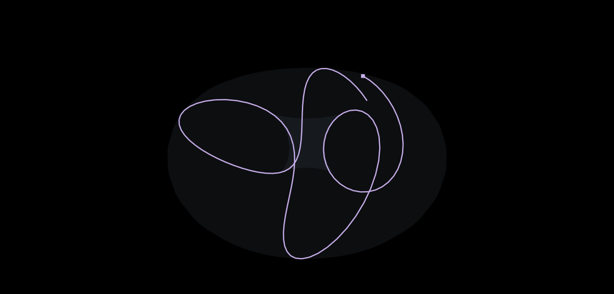

# 第3軌跡の計算レビューと強調画像

現在の第3は実際の円運動を追加するモデルへ更新しています。[現在の数式・画像・検証](THIRD_CIRCLE.md)。以下は旧位相モデルの記録です。

2026-11-13 UTC。対象はPR #16の `672b08d` からのトーラス・第3軌跡。座標、面の恒等式、3Dの行列、描画、選択、Exportとテストを確認した。

## 結果

現行の定義 `Q=T(u±π/2,v)=(∓y,±x,z)` に対する計算の誤りは見つからなかった。第3は同じトーラス上の位相をずらした軌跡であり、向きの異なる第3の輪を生成する式にはなっていない。長い履歴では3本とも同じ面に重なるため、全体が1つのトーラスに見える。この定義と、参照画像から期待する立体構造が一致するかは区別して判断する必要がある。

**表示の不具合を1件修正した。** 太線用のShaderMaterialがThree.jsの線形RGBをそのまま出力していたため、指定した紫 `#cbb0ed` が `#986fd8` に暗くなっていた。細線は正常だった。`linearToOutputTexel` で出力先の色空間へ変換し、太線の不透明な中心部分も細線と同じ `#cbb0ed` になることを実画素で確認した。座標・位相・陰陽・幾何学digestを維持した修正である。

## 第3が見える画像

以下はアプリの実際のPNG保存と動画保存。画像の色や形を保存後に加工していない。表示条件はπ、r1=1.3、r2=1、scale=100（R=130、r=100）、dt=0.05、step 1〜126。第3の濃さを95%、線幅3として、長い履歴による重なりを避けた。灰色は同じ半径の補助面。説明なし表示を使い、装置の腕の補助線を非表示にしている。

- [陰陽を薄く、第3を明るく重ねた画像](third-flow-review/focused-three.png)
- [第3だけを描く3秒MP4](third-flow-review/focused-third.mp4)
- [撮影条件と独立計算・画素の記録](third-flow-review/review.json)
- [修正前の画素と独立計算の記録](third-flow-review/review-before.json)

これらは見やすい設定での撮影であり、アプリの既定値は第3オフ、オンにしたときの濃さ23%のまま。

## 独立した数値照合

実装が使う定数・角度還元・座標の交換式を参照せず、Python標準ライブラリのDecimal（230桁）でπをGauss–Legendre法から計算した。sin / cosはテイラー級数で求め、`T(u,v)`、`T(u+π,−v)`、`T(u+π/2,v)`、`T(u−π/2,v)` を直接評価した。float入力はそのIEEE-754の厳密な値として解釈する。

π / 22⁄7、リング / ホーン / スピンドル / 球・円・点の6領域、n=1 / 300 / 10¹² / 2⁵³−1 / 10³⁰、複数dtの60条件、計240組の座標を照合した。

| 確認                                                         | 結果                     |
| ------------------------------------------------------------ | ------------------------ |
| 座標の最大正規化誤差 `max(abs(actual−reference))/max(1,R+r)` | 2.075×10⁻¹⁶              |
| 面の陰関数の最大正規化残差                                   | 6.768×10⁻¹⁶              |
| 判定基準                                                     | いずれも4×10⁻¹⁵未満      |
| 修正前の太線で最も多い紫の画素（濃さ100%）                   | RGB(152,111,216)         |
| 修正後の太線で最も多い紫の画素（濃さ100%）                   | RGB(203,176,237)＝指定色 |

第3は大円方向の位相だけを変え、`Qx²+Qy²=x²+y²` と `Qz=z` を保つ。従って元と同じトーラスの陰関数恒等式を満たす。陰陽の対は正確な中心反転であり、Qを加えた3本全体の中心対称性は仮定していない。3Dの変換行列、Inspector、CSV / SVGは同じ定義を使っている。

参照値は `tools/validation/third-flow-reference.py` で再生成できる。参照値との照合を単体テストに追加し、太線の実際の色をE2Eの回帰検査に追加した。PNG / 動画と数学の検証記録はViteを4175で起動して `node tools/validation/third-flow-focus.mjs` で再生成できる。

座標はfloat64、GPUはfloat32。πも実装では120桁を448-bitの形式へ変換した有限精度である。今回の範囲では誤差がfloat64の丸めの範囲に収まることを確認している。点を結ぶ線分の途中まで面上にあるという保証や、物理的エネルギーの計算は加えていない。

## 再検証

- typecheck / lint / build: PASS
- 単体: 32 files / 439 tests PASS（独立参照の照合を1件追加）
- Chromium E2E全体: 50 / 50 PASS（太線の実画素の色も照合）。
- WebGL無効の第3 E2E: 3 / 3 PASS。
- 最新HEADのFirefox / WebKitを含むCI結果はPR #16に記載する。mainへはマージしない。
